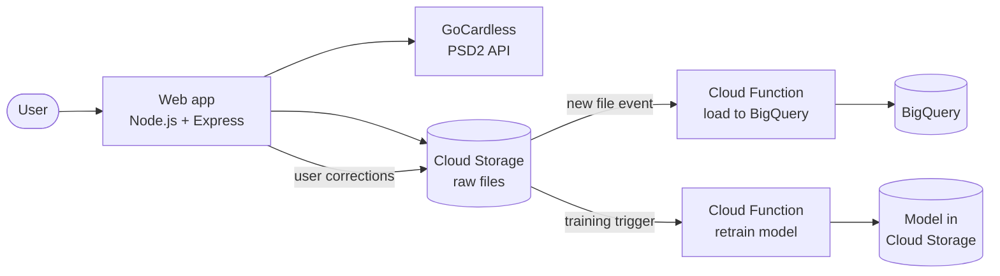

# Bank data platform

Open banking and machine learning on Google Cloud. The app pulls my own bank transactions (mBank, PKO BP) through a PSD2 API, sorts them into categories with an ML model, and learns from every correction I make in the dashboard.

**Status:** being rebuilt · built solo

> The source code is private. This repository is a showcase: architecture and key engineering decisions. I am happy to walk through the full code in an interview.

## Architecture

## Engineering highlights

### 1. Open banking
- Transactions from mBank and PKO BP through the GoCardless Bank Account Data API (PSD2).
- The 90-day bank consent is handled in the app: days left until it expires, and a new consent link when it is needed.

### 2. Event-driven pipeline on Google Cloud
- New files in Cloud Storage trigger Cloud Functions (Gen 2, Python) through Eventarc.
- The load function maps categories, removes duplicates from overlapping downloads, and loads BigQuery.

### 3. Human-in-the-loop machine learning
- A TF-IDF + Random Forest model sorts transactions into categories.
- Every correction in the dashboard becomes training data and starts a retraining run.
- Retraining runs only after a data-consistency gate (row counts, row hashes of the training and test sets, empty values) and a backup of the data. The result goes back to the app as a status.

### 4. Infrastructure and delivery
- Terraform modules for BigQuery, Cloud Run and Cloud Storage, with separate DEV and PROD environments and remote state in Cloud Storage.
- GitHub Actions deploys to Google Cloud and to an ARM device. Multi-arch Docker builds with a registry layer cache: from about 8–10 min to about 1–2 min.
- About 210 API tests (Mocha) and git hooks before each commit.

## Stack

| Layer | Technology |
|---|---|
| App | Node.js, Express, JavaScript |
| Data and ML | Python, BigQuery, Cloud Storage, scikit-learn |
| Cloud | Google Cloud Functions (Gen 2), Eventarc, Cloud Run |
| Delivery | Terraform, Docker (multi-arch), GitHub Actions |
